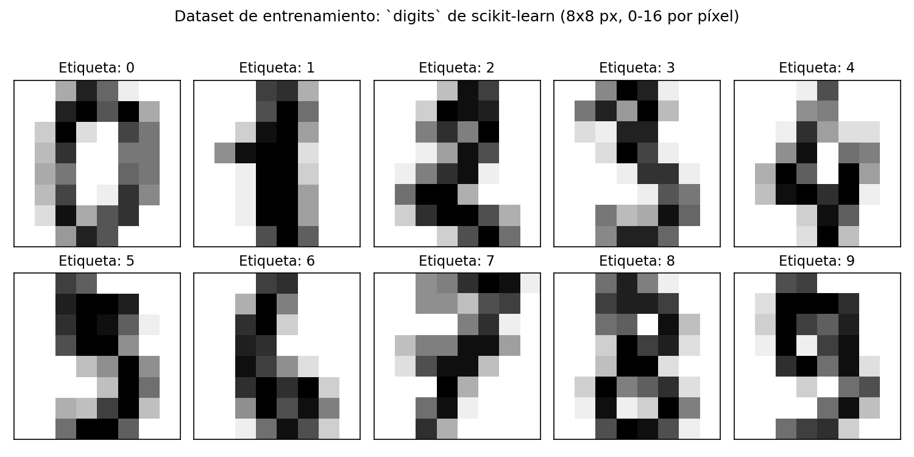
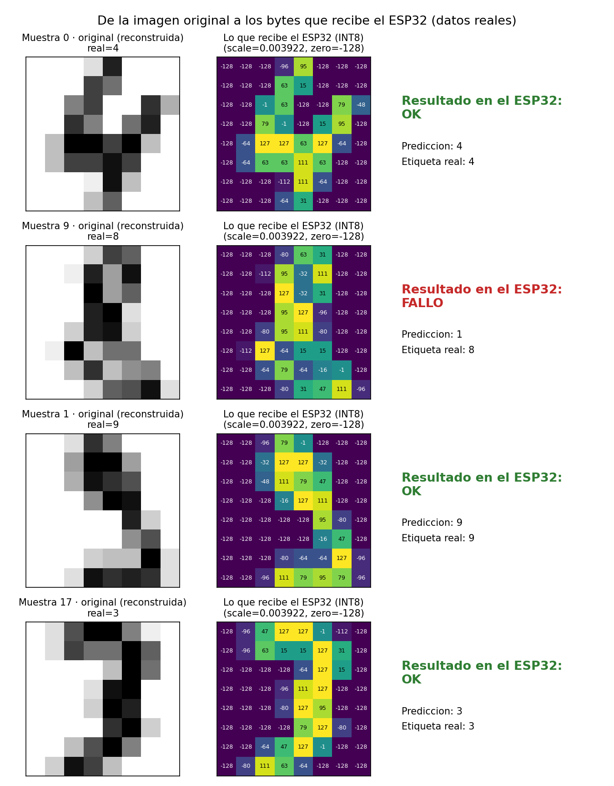
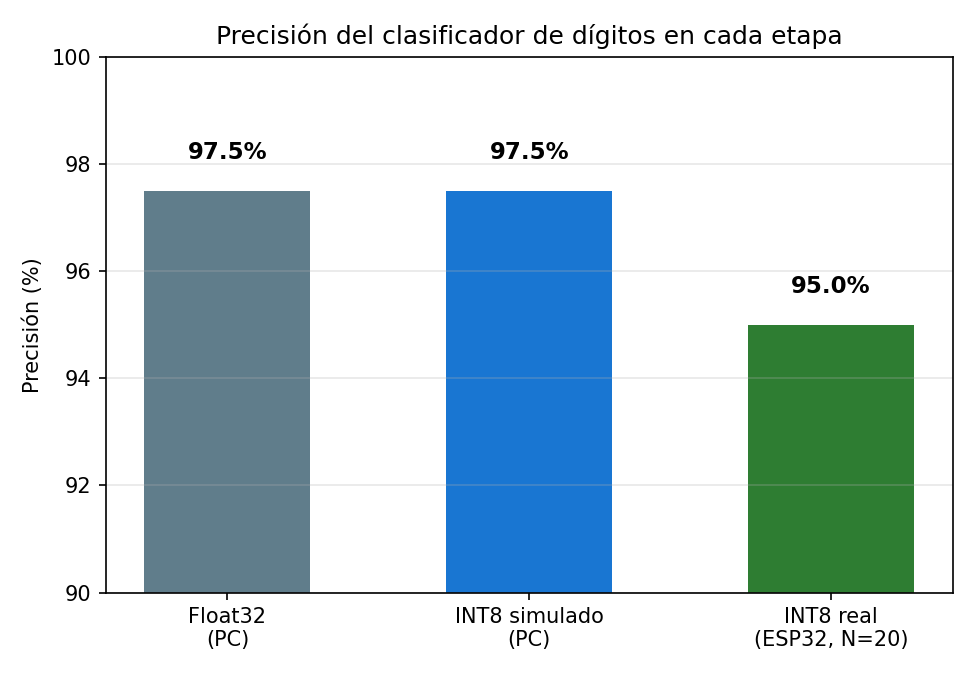

# esp32_digits: un clasificador de dígitos entrenado en el PC, ejecutado en un ESP32

Un modelo de IA real (una red neuronal) entrenado en el PC, cuantizado a INT8 y ejecutado
dentro de un ESP32 clásico (sin PSRAM, sin cámara) con **TensorFlow Lite Micro**. El chip
clasifica correctamente dígitos manuscritos de 8x8 píxeles en menos de medio milisegundo.

**Resultado final:** 19/20 aciertos (95 %) en el propio chip, 408 µs por inferencia, usando
solo 1132 de los 20 KB de memoria reservados.

## Índice

1. [Por qué entrenar en el PC y no en el ESP32](#1-por-qué-entrenar-en-el-pc-y-no-en-el-esp32)
2. [El dataset](#2-el-dataset)
3. [El modelo](#3-el-modelo)
4. [Pipeline completo](#4-pipeline-completo)
5. [`train_and_convert.py`: entrenar y cuantizar](#5-train_and_convertpy-entrenar-y-cuantizar)
6. [De la imagen al byte: la cuantización INT8](#6-de-la-imagen-al-byte-la-cuantización-int8)
7. [`main.cc`: ejecutar el modelo en el ESP32](#7-maincc-ejecutar-el-modelo-en-el-esp32)
8. [Cómo ejecutarlo, paso a paso](#8-cómo-ejecutarlo-paso-a-paso)
9. [Resultados](#9-resultados)
10. [Problemas encontrados y solución](#10-problemas-encontrados-y-solución)
11. [Posibles mejoras](#11-posibles-mejoras)

---

## 1. Por qué entrenar en el PC y no en el ESP32

Entrenar significa ajustar miles de pesos con *backpropagation*, repitiendo ese cálculo
decenas de veces sobre todo el dataset (épocas). Eso necesita mucha RAM, mucha CPU y
librerías como TensorFlow, nada de lo cual tiene un microcontrolador. Un ESP32 clásico
tiene ~520 KB de RAM y ningún soporte para entrenar redes.

Lo que sí puede hacer un ESP32 es **inferencia**: aplicar un modelo ya entrenado a un dato
nuevo. Esa operación es solo una serie de multiplicaciones y sumas con los pesos ya fijos,
mucho más barata. Por eso el flujo siempre es:

```
Entrenar en el PC  →  Cuantizar a INT8  →  Convertir a array C  →  Ejecutar (solo inferencia) en el ESP32
```

Este reparto de trabajo (entrenar en un ordenador potente, inferir en un chip diminuto) es
la base de todo TinyML.

## 2. El dataset

Se usó el dataset **`digits`** de scikit-learn: 1797 imágenes de dígitos manuscritos, de
**8x8 píxeles** en escala de grises (valores de 0 a 16). Viene incluido en la librería, no
hace falta descargar nada aparte.

No es el famoso MNIST (ese usa imágenes de 28x28, mucho más grandes); se eligió `digits`
precisamente porque sus imágenes, ya diminutas, dan un modelo pequeño que cabe de sobra en
un ESP32 sin PSRAM.



Un ejemplo de cada dígito (0-9) tal y como entra al modelo: 64 números (8x8) entre 0 y 16.

## 3. El modelo

Una red densa muy simple:

```
Entrada: 64 valores (imagen 8x8 aplanada, normalizada a 0-1)
   │
   ▼
Dense(32) + ReLU        ← 64×32 + 32 = 2080 parámetros
   │
   ▼
Dense(10) + Softmax     ← 32×10 + 10 =  330 parámetros
   │
   ▼
Salida: 10 valores (probabilidad de cada dígito 0-9)
```

Total: **2410 parámetros**, unos 9.4 KB en float32, o unos **2.4 KB una vez cuantizados a
INT8** (1 byte por parámetro en vez de 4). El modelo `.tflite` final pesa 5544 bytes
(incluye también la metadata del formato FlatBuffer, no solo los pesos).

Es intencionadamente pequeño: el objetivo no es el dígito en sí, sino demostrar el flujo
completo (entrenar → cuantizar → ejecutar en el chip) con algo que sí funciona de verdad,
no un ejemplo de juguete como `hello_world`.

## 4. Pipeline completo

```
  EN EL PC (train_and_convert.py)                    EN EL ESP32 (main.cc)
  ────────────────────────────────                   ─────────────────────
  1. Entrenar (Keras, 60 épocas)
  2. Cuantizar a INT8 (TFLite)        ──genera──▶     model_data.cc/.h
  3. Exportar como array C            ──genera──▶     test_samples.h
                                                       │
                                                       ▼
                                                 MicroInterpreter.Invoke()
                                                       │
                                                       ▼
                                                 Resultado por UART
```

Un único script de Python (`train_and_convert.py`) hace todo el trabajo de PC. Lo único
que viaja al ESP32 son tres archivos generados: `model_data.cc`, `model_data.h` y
`test_samples.h`.

## 5. `train_and_convert.py`: entrenar y cuantizar

Sus pasos, en orden:

1. **Cargar y dividir los datos.** `train_test_split` con semilla fija (`SEED = 42`) para
   que el experimento sea reproducible: 1437 muestras de entrenamiento, 360 de test.
2. **Definir y entrenar el modelo** (`tf.keras.Sequential`, 60 épocas, optimizador Adam).
3. **Evaluar en float32** sobre las 360 muestras de test — la precisión "ideal", sin ningún
   error de cuantización.
4. **Cuantizar a INT8** con `TFLiteConverter`, usando un *representative dataset* (200
   muestras reales) para que el conversor calibre el rango de valores de cada capa.
   Entrada y salida también se cuantizan a INT8 (`inference_input_type` /
   `inference_output_type`), que es lo que espera TFLite Micro.
5. **Evaluar el modelo ya cuantizado**, simulado en el PC con el intérprete normal de
   TFLite, para saber cuánta precisión se pierde por cuantizar antes de tocar el chip.
6. **Exportar el modelo como array C** (`model_data.cc` / `.h`): convierte los bytes del
   `.tflite` en una tabla `const unsigned char[]`, que es como un microcontrolador sin
   sistema de archivos puede "leer" un modelo — está embebido directamente en el firmware.
7. **Exportar 20 muestras de test ya cuantizadas** (`test_samples.h`): para no tener que
   enviar imágenes al ESP32 en tiempo real, se cuantizan 20 imágenes de test de antemano y
   se incrustan también como arrays C, junto con su etiqueta real.

## 6. De la imagen al byte: la cuantización INT8

Cuantizar significa pasar de números en coma flotante (float32, 4 bytes cada uno) a enteros
de 8 bits (INT8, 1 byte), usando una escala y un punto cero: `valor_int8 = round(valor_float
/ scale + zero_point)`. Esto hace el modelo 4 veces más pequeño y mucho más rápido en una
CPU sin unidad de coma flotante dedicada, a cambio de perder algo de precisión.



En este entrenamiento, `scale ≈ 0.003922` y `zero_point = -128` para la entrada (estos
valores salen impresos al ejecutar `train_and_convert.py`, y pueden variar ligeramente
entre entrenamientos). La columna central de la figura es exactamente lo que recibe
`input->data.int8[]` en el ESP32: ya no es una imagen reconocible a simple vista, son solo
números, pero el modelo fue entrenado para reconocer ese patrón.

La fila del medio es la **muestra 9**, la única que el ESP32 clasificó mal (predijo 1,
era un 8). Es un fallo del modelo, no de la cuantización: ya en el PC, antes de cuantizar
nada, el modelo se equivoca en algunas imágenes ambiguas — con solo 1437 ejemplos de
entrenamiento y una red tan pequeña, un 2-3% de error es esperable.

## 7. `main.cc`: ejecutar el modelo en el ESP32

El firmware, línea a línea:

**Cargar el modelo e inicializar TFLite Micro**
```cpp
const tflite::Model* model = tflite::GetModel(g_digits_model_data);
```
`g_digits_model_data` es el array de bytes generado por el script. `GetModel` lo interpreta
como un FlatBuffer de TFLite sin copiarlo a ningún otro sitio: vive directamente en flash.

**Registrar solo las operaciones necesarias**
```cpp
static tflite::MicroMutableOpResolver<3> resolver;
resolver.AddFullyConnected();
resolver.AddRelu();
resolver.AddSoftmax();
```
TFLite Micro no incluye todos los operadores posibles por defecto (ocuparía demasiado
espacio); hay que declarar explícitamente cuáles usa el modelo. Este, al ser una red densa
simple, solo necesita estos tres.

**Reservar el "arena" de memoria e inicializar el intérprete**
```cpp
constexpr int kTensorArenaSize = 20 * 1024;
alignas(16) uint8_t tensor_arena[kTensorArenaSize];
...
static tflite::MicroInterpreter interpreter(model, resolver, tensor_arena, kTensorArenaSize);
interpreter.AllocateTensors();
```
El "arena" es el bloque de RAM donde TFLite Micro coloca los tensores intermedios durante
la inferencia (no hay heap dinámico como en un PC). `AllocateTensors()` calcula y reparte
ese espacio. El tamaño (20 KB) es una estimación prudente; el propio log del programa dice
cuánto se usó realmente (1132 bytes en esta ejecución), así que se podría reducir mucho.

**El bucle de inferencia**
```cpp
for (int i = 0; i < NUM_TEST_SAMPLES; i++) {
  // copiar la muestra i al tensor de entrada
  for (int j = 0; j < INPUT_SIZE; j++) input->data.int8[j] = g_test_input[i][j];

  int64_t t0 = esp_timer_get_time();
  interpreter.Invoke();          // <- aquí ocurre la inferencia
  int64_t t1 = esp_timer_get_time();

  // leer la salida y quedarse con el índice más alto (argmax)
  ...
}
```
`Invoke()` es la función que de verdad ejecuta el modelo: multiplica la entrada por los
pesos de la primera capa, aplica ReLU, multiplica por los pesos de la segunda, aplica
Softmax, y deja el resultado en el tensor de salida. `esp_timer_get_time()` mide el tiempo
en microsegundos antes y después, para medir cuánto tarda.

Como la salida es un Softmax cuantizado, basta con mirar qué posición tiene el valor más
alto (el argmax): la cuantización no cambia cuál es el máximo, así que no hace falta
deshacerla para clasificar.

## 8. Cómo ejecutarlo, paso a paso

### 8.1 En el PC: entrenar y generar los archivos

```powershell
cd digits_model_esp32
python -m venv venv_tf
venv_tf\Scripts\activate
pip install tensorflow scikit-learn numpy
python train_and_convert.py
```

Genera `model_data.cc`, `model_data.h` y `test_samples.h` en esa misma carpeta.

### 8.2 Copiar los archivos al proyecto ESP-IDF

```powershell
copy model_data.cc  esp32_digits\main\
copy model_data.h   esp32_digits\main\
copy test_samples.h esp32_digits\main\
```

### 8.3 Compilar y flashear (entorno ESP-IDF activo)

```powershell
cd esp32_digits
idf.py add-dependency "espressif/esp-tflite-micro"
idf.py set-target esp32
idf.py build
idf.py -p COM3 flash monitor
```


## 9. Resultados

| Etapa | Precisión | Notas |
|---|---|---|
| Float32 (PC) | 97.5 % | Sobre las 360 muestras de test, antes de cuantizar |
| INT8 simulado (PC) | 97.5 % | Mismo modelo ya cuantizado, probado con el intérprete de TFLite normal |
| INT8 real (ESP32) | 95.0 % (19/20) | Las 20 muestras de `test_samples.h`, ejecutadas en el chip |



*De dónde sale cada cifra:* el 97.5 % (float32 e INT8 simulado) lo imprime directamente
`train_and_convert.py` al ejecutarse en el PC (líneas "Precisión en float32" y "Precisión
en INT8"). El 95 % del ESP32 se cuenta sobre las líneas `OK`/`FALLO` que imprime `main.cc`
por el monitor serie, una por cada una de las 20 muestras de `test_samples.h`.

La cuantización apenas costó precisión en el PC (97.5 % → 97.5 %, sobre 360 muestras). El
95 % del ESP32 es sobre un conjunto mucho más pequeño (20 muestras: un solo fallo ya son 5
puntos), así que no es comparable en rigor estadístico con el 97.5 % de arriba; lo normal
es que se mantenga en ese rango.

**Rendimiento en el chip** (ESP32-D0WD-V3, 160 MHz):

| Métrica | Valor |
|---|---|
| Tiempo medio de inferencia | 408 µs |
| Memoria usada (arena) | 1132 de 20480 bytes reservados (5.5 %) |
| Tamaño del modelo en flash | 5544 bytes |

Con 408 µs por inferencia, el chip podría clasificar más de 2000 imágenes por segundo si
hiciera falta.

## 10. Problemas encontrados y solución

| Problema | Causa | Solución |
|---|---|---|
| `AttributeError: partially initialized module 'jax'` | Keras 3 intenta importar `jax` al arrancar (para una función de checkpoints), aunque no se use como backend | Forzar `os.environ["KERAS_BACKEND"] = "tensorflow"` al principio del script, antes de importar TensorFlow |
| El venv no se activaba (`ImportError: DLL load failed... Control de aplicaciones`) | Se instaló TensorFlow dentro del venv de ESP-IDF por error, y una política de Windows bloqueó una DLL | Crear un venv nuevo, fuera de `C:\Espressif`, para el entrenamiento |
| `fatal error: cstdio: No such file or directory` al compilar | El código quedó pegado en el `.c` que crea `idf.py create-project` por defecto, compilado como C, no como C++ | Crear `main.cc` como archivo nuevo y borrar el `.c` por defecto, actualizando `CMakeLists.txt` |
| `includes esp_timer.h... not in the requirements list` | Faltaba declarar la dependencia del componente `esp_timer` | Añadir `PRIV_REQUIRES esp_timer` en `main/CMakeLists.txt` |
| Cientos de `error: expected primary-expression before ',' token` en `model_data.cc` | Bug en el script: al cortar el texto ya formateado en trozos de 96 caracteres, cada línea coincidía con terminar justo en una coma, y el `join` añadía otra coma detrás (`,,`) | Reescribir `to_c_array()` para construir cada línea a partir de los bytes directamente, no cortando el string ya formateado |

## 11. Posibles mejoras

Ideas para seguir, de más a menos inmediatas:

- **Reducir `kTensorArenaSize`.** El log dice que solo se usan 1132 de los 20480 bytes
  reservados. Bajarlo a, por ejemplo, 4096 libera RAM sin coste real.
- **Indicador visual de acierto/fallo.** Reutilizar el LED del ejercicio `blink` (GPIO 2):
  encenderlo en verde lógico un instante si acierta, parpadear rápido si falla. Útil para
  una demo sin monitor serie delante.
- **Probar el conjunto de test completo** (las 360 muestras, no solo 20) en vez de una
  selección aleatoria, para tener una cifra de precisión en el chip directamente comparable
  con el 97.5 % del PC. El modelo es tan pequeño que las 360 muestras cuantizadas caben
  de sobra en flash.
- **Enviar una imagen por el puerto serie en tiempo real** (por ejemplo, 64 números
  separados por comas) y que el ESP32 la clasifique al vuelo, en lugar de usar siempre las
  mismas 20 muestras precargadas. Convertiría el proyecto en una demo interactiva real.
- **Matriz de confusión.** En vez de solo acierto/fallo, registrar qué dígito se confunde
  con qué otro — más útil si se amplía el dataset o se repite el experimento con MNIST
  completo en un ESP32-S3 con PSRAM.
